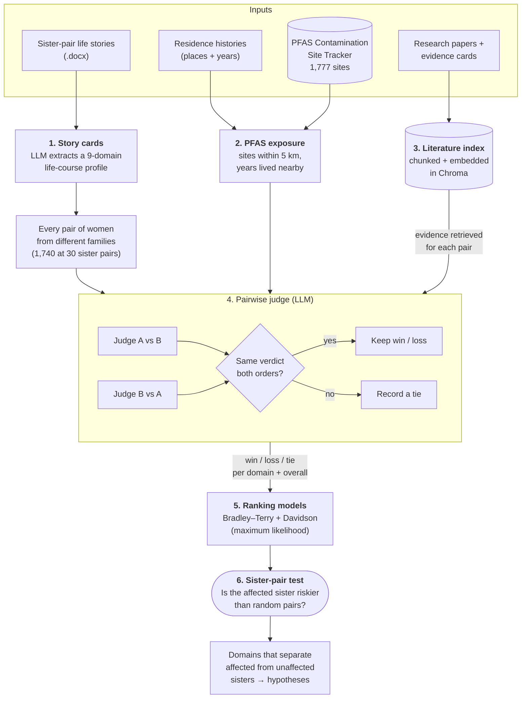
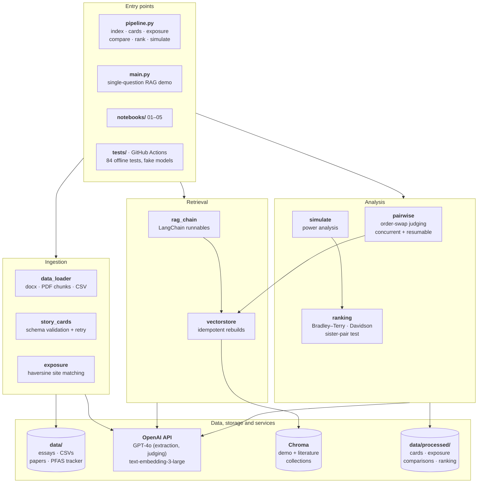

# Breast Cancer Risk Factor Analysis using RAG and LLMs

[](https://github.com/codemanav/Breast_Cancer_RAG/actions/workflows/tests.yml)

An AI-assisted research framework for finding non-genetic risk factors for
**young adult breast cancer (YABC)**, diagnosed before age 40. It combines
interview narratives from biological sister pairs, scientific literature,
environmental exposure data, and paired-comparison statistics.

Each sister pair has one sister diagnosed before 40 and one who is
cancer-free. Sisters share much of their genetics and upbringing, so
consistent differences in their life-course exposures point toward
non-genetic factors worth investigating.

**Principal investigator:** Professor Rosemary Danaher, North Carolina State University
**Software engineering and research:** Manav Shah (part-time software engineer and researcher)

> This is an exploratory, hypothesis-generating research tool. It is not a
> clinical diagnostic, does not predict individual cancer risk, and does not
> establish causation.

## How it works



1. **Story cards.** The LLM converts each participant's life story into a
   structured card covering a timeline, nine life-course domains (allostatic
   load, circadian/sleep, metabolic, reproductive/hormonal, substance use,
   environmental/occupational, social determinants, healthcare engagement,
   diet), interactions, and quotes kept for provenance. Output is validated,
   the model is retried once on malformed output, and participant IDs are set
   by the code, never taken from the model.
2. **PFAS exposure.** Each residence (with years lived) is matched to known
   PFAS contamination sites within a radius (default 5 km) using great-circle
   distance, giving site counts, nearest site, peak PFOA+PFOS levels, and years
   lived near contamination. Unknown durations are flagged, not guessed.
3. **Literature retrieval.** Evidence cards and research-paper PDFs (chunked
   with page numbers kept for citation) are embedded into their own Chroma
   collection. Retrieval for each pair is driven by the evidence topics in
   both story cards.
4. **Pairwise judging.** For every pair of participants from *different*
   families, the LLM judges whose exposures were riskier in each domain and
   overall (win/loss/tie), citing retrieved evidence. Each pair is judged
   **twice with A/B order swapped**. A verdict counts only if both orders
   agree; otherwise it becomes a tie, which removes position bias. The
   order-swap agreement rate is reported as a reliability measure.
5. **Ranking and the sister-pair test.** Win/loss/tie outcomes are fitted with
   Bradley–Terry (ties as half-wins) and Davidson (explicit tie parameter)
   models by maximum likelihood. If the judgments carry real signal, the
   affected sister should rank as riskier than her unaffected sister more often
   than random pairs do. The statistic is the mean P(affected riskier) over
   sister pairs, tested against a null distribution of random non-sister pairs
   with random orientation. This runs overall and for each domain, which shows
   which domains consistently separate affected from unaffected sisters.

With the target of 30 sister pairs (60 participants) there are
C(60, 2) − 30 = **1,740** non-sister pairs to judge.

## System architecture

Two entry points share one set of modules. `pipeline.py` runs the study, and
`main.py` is the original single-question demo. The literature and the demo
each have their own Chroma collection, so the judge only ever retrieves
scientific evidence, never another participant's story. The tests replace
OpenAI with deterministic fakes, so the whole system runs offline in CI.



## Study-design power analysis

`python pipeline.py simulate` simulates the whole design: shared family risk,
individual risk, an effect for the affected sister, and Davidson-distributed
judgments with ties. It then reports how often the sister-pair test detects
the effect at α = 0.05 (200 simulated studies per cell):

| Sister pairs | 0.25 SD | 0.5 SD | 0.75 SD | 1.0 SD |
|---:|---:|---:|---:|---:|
| 10 | 0.09 | 0.19 | 0.32 | 0.52 |
| 20 | 0.11 | 0.32 | 0.53 | 0.78 |
| 30 | 0.15 | 0.42 | 0.76 | 0.96 |
| 40 | 0.20 | 0.56 | 0.91 | 0.99 |

At the planned 30 pairs the test reliably detects effects of about 0.75 SD
or larger; detecting smaller effects would need more pairs. With no effect it
rejects about 5% of the time, as it should.

## Current data status

| Input | Status |
|---|---|
| Sister-pair narratives | 1 pair (MaryAnne and Sue). The study targets 30 pairs; recruitment is ongoing. |
| Affected/unaffected labels | Not recorded for the pilot pair. When known, set `affected` to yes/no in `data/participants.csv`; until then the sister-pair test skips that pair. |
| Research papers | 2 open-access papers (CC BY 4.0) in `data/papers/`, plus evidence cards for both. Add more PDFs there. |
| PFAS sites | PFAS Contamination Site Tracker, May 2024, in `data/external/` (1,777 geocoded sites). |
| Residence histories | Taken from the essays in `data/residences.csv`, with coordinates at the town level. |

With a single sister pair there are no non-sister pairs to judge yet.
`python pipeline.py compare --sisters` judges the sister pair directly, and
the full ranking analysis runs as participants are added.

## Setup

Python 3.11+ is recommended.

```bash
python -m venv .venv
source .venv/bin/activate
pip install -r requirements.txt
cp .env.example .env   # then add your OpenAI key
```

## Running the study pipeline

```bash
python pipeline.py index              # embed evidence cards + paper PDFs
python pipeline.py cards              # life stories -> story cards
python pipeline.py exposure           # PFAS exposure from residence history
python pipeline.py compare --sisters  # pairwise judging (resumable)
python pipeline.py rank               # Bradley–Terry / Davidson + sister test
python pipeline.py simulate           # power analysis (no data or key needed)
```

`compare` judges pairs concurrently (`--workers`) and appends each result as
it finishes. If a run is interrupted or rate-limited, rerun the same command
to continue from where it stopped; failed pairs are retried. Use `--limit N`
for a small trial run before judging all pairs.

Inputs: `data/participants.csv` (ID, sister-pair ID, affected yes/no, essay
file) and `data/residences.csv` (place, coordinates, start/end year, or
`present`). Outputs go to `data/processed/`, which Git ignores.

## Single-question demo

`main.py` answers one comparison question over the two essays and evidence
cards (the original proof of concept):

```bash
python main.py --query "Compare the stressors in MaryAnne and Sue's lives."
```

Notebooks `01`–`04` walk through that demo step by step. Notebook `05` shows
the study pipeline's outputs and a power curve.

## Tests

```bash
pip install -r requirements-dev.txt
pytest
```

84 tests run fully offline in about 10 seconds, using deterministic fake
models and temporary data, and GitHub Actions runs them on every push. They
cover:

- **Statistics:** recovery of known strengths and tie rates, an exact gradient
  check against finite differences, the 1,740-pair design count, detection of
  a real effect, and a calibrated false-positive rate.
- **Judge:** position-bias removal (a judge that always picks the first option
  yields only ties), verdict parsing, and resumable runs that survive failures.
- **Exposure:** distance math, radius filtering, unknown versus current
  residences, and parsing of messy tracker values (`"<4"`, `"1,200"`, `"ND"`).
- **End to end:** a synthetic study of 8 sister pairs goes through every
  pipeline command, and the affected sisters are recovered with a significant
  sister-pair test.

## Data sources and licensing

- **PFAS Contamination Site Tracker** (May 2024): PFAS Project Lab, Social
  Science Environmental Health Research Institute, Northeastern University.
  Included with the lab's permission. Any public use of results derived from
  it must credit the lab and be shared with the lab at least 7 days before
  release; see [data/external/README.md](data/external/README.md).
- **Research papers**: open access under CC BY 4.0; citations are in
  [data/papers/README.md](data/papers/README.md).
- **Essays**: shared with the participants' consent for this project.

## Limitations

- A PFAS site's sample date is when contamination was *detected*, not when it
  began, so proximity is a screening signal, not a dose estimate. Residence
  coordinates are town centroids.
- LLM judgments can be wrong. The order swap removes position bias but not
  other errors, so findings are hypotheses to check against the cited
  evidence, not conclusions.
- Statistical power depends on recruitment; see the power analysis above.
